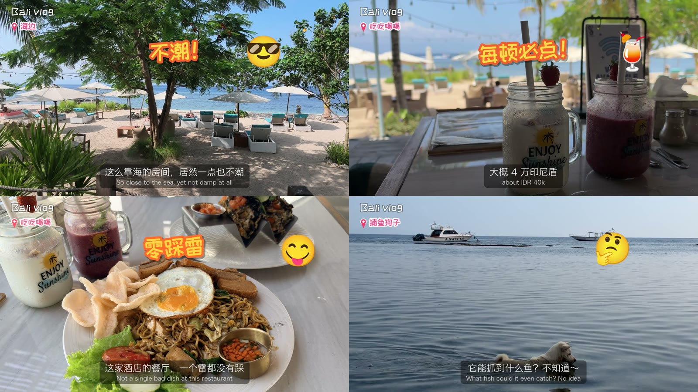

# vlog-studio

**把手机 / 相机拍的生活素材，剪成可以直接发小红书、B 站、抖音的 vlog。**
交给你的 AI 编程助手（Claude Code、Codex 等），说一句「帮我把这些素材剪成 vlog」，它会看素材、转写语音、写口播稿、出分镜给你确认，然后剪出带中英双语字幕、章节标签、花字、动态贴图和音效的成片。

[English](#english) · [一键安装](SETUP_PROMPT.md) · [安装](#安装) · [第一次使用](#第一次使用新手-6-步) · [怎么用](#怎么用)



<sub>示例画面来自一支海岛酒店 room tour：花字「不潮！」「每顿必点！」「零踩雷」、动态表情贴图、双语字幕、左上角角标和章节标签都是这个 skill 自动做的。</sub>

> **🤖 给 AI 助手：** 如果用户把这个仓库链接发给你、让你安装或配置 vlog-studio，请按 [SETUP_PROMPT.md](SETUP_PROMPT.md) 里的 6 个步骤执行（安装 skill → 运行 `scripts/doctor.py` 自检并修好 ❌ → 征得同意后 `doctor.py --prefetch` 下载模型 → 问用户 3 个问题建立风格档案 → 征得同意后运行 `setup_library.py` 建素材库 → 告诉用户怎么开始）。装软件、下载大文件、改设置之前，先告诉用户要做什么、多大，等用户同意。
>
> **For AI agents:** if a user shares this repo and asks you to install or set up vlog-studio, follow the 6 steps in [SETUP_PROMPT.md](SETUP_PROMPT.md). Ask the user before installing software, downloading large files or changing settings.

**最简单的安装：把这个仓库链接发给你的 Claude Code 或 Codex，说一句「帮我装上这个」就行。**

## 能做什么

| | |
|---|---|
| **三种视频** | 旁白口播 + 画面（先拍后录）、对镜头口播（自拍 / 合照说话）、纯画面 vlog |
| **人声清理** | 本地转写，找出停顿、说了两遍的句子、说错的词，剪掉后再转写一遍核对没切掉字 |
| **现场原声** | 拍摄时随口说的「哇好用心」「好喜欢这个床」会被找出来，和后期口播混剪，更有活人感 |
| **双语字幕** | 中文在上英文在下（可改），长句按标点自动拆开，同时导出 SRT 可导入剪映 |
| **包装** | 左上角固定角标、章节标签滑入、花字弹出、信息卡（日期 · 地点 · 价格）、照片小窗、快剪开场 |
| **动态贴图** | Google Noto 动态表情（带透明），可以**跟着人脸走**（说到「婚礼」时两人脸旁各飘一颗爱心） |
| **音效** | 换章节、拍照、花字弹出等时刻自动加音效，人声说话时环境声自动压低，整片统一响度 |
| **先出分镜** | 渲染前一定先出分镜页：每段一张样张，贴图、花字、信息卡都画在真实位置，确认后才生成视频 |
| **变速** | 整片 1.2 倍速等，人声音调不变，字幕同步 |

## 工作流程

```
看素材 → 转写人声 → 写口播稿 / 选现场原声 → 剪停顿和重复 → 搭时间线
      → 出分镜，等你确认 → 渲染 → 重新转写成片自查 → 交付 MP4 + SRT
```

每一步需要你决定的事（画幅、口播稿、保留哪些原声、分镜）都会停下来问你；字幕只写你说过的话，不替你编感受。

## 最省事的安装：把链接发给你的 AI

对你的 Claude Code 或 Codex 说：

```text
帮我装上这个：https://github.com/JessieSun-vibe/vlog-studio
```

如果它只装了一半，就打开 [SETUP_PROMPT.md](SETUP_PROMPT.md)，把里面那段完整的话整段复制粘贴给它。它会自己完成：安装 skill → 检查电脑缺什么并帮你装好 → 提前下载语音识别模型 → 问你 3 个问题建立风格档案 → 建立素材库。需要装软件或下载大文件时，它会先问你。

想自己一步步装，看下面。

## 安装

### 电脑要求
- **Mac（Apple 芯片，M1 及以后）**：全部功能可用（本地语音转写用 mlx-whisper）。
- Windows / Intel Mac：剪辑和渲染部分可以跑，本地转写暂不支持（欢迎 PR）。
- 需要先装好：[ffmpeg](https://ffmpeg.org/)（带 libvpx）、Python 3、[uv](https://docs.astral.sh/uv/)。其余依赖第一次使用时自动安装。

```bash
brew install ffmpeg uv
```

### Claude Code（推荐）

```bash
claude plugin marketplace add JessieSun-vibe/vlog-studio
```
```bash
claude plugin install vlog-studio@vlog-studio
```

更新：
```bash
claude plugin marketplace update vlog-studio && claude plugin update vlog-studio@vlog-studio
```

### Codex 或其他支持 SKILL.md 的工具

```bash
git clone https://github.com/JessieSun-vibe/vlog-studio.git ~/vlog-studio
```
```bash
mkdir -p ~/.codex/skills && ln -s ~/vlog-studio/plugin/skills/vlog-studio ~/.codex/skills/vlog-studio
```

其他工具把 `plugin/skills/vlog-studio` 放进它们的 skills 文件夹即可。更新时在 `~/vlog-studio` 里 `git pull`。

## 第一次使用（新手 6 步）

1. **装好工具**（只需要一次）：
   ```bash
   brew install ffmpeg uv
   ```
2. **安装 skill**：用上面「安装」里的命令。要正式剪片时，**新开一个 Claude Code 会话**，skill 才会自动生效（安装、自检、建素材库在当前会话就能做）。
3. **准备素材**：一支片子一个文件夹，视频、照片、口播录音都放进去。口播用手机「语音备忘录」录就行（设置里音质选「无损」），说错了停一下，从这句开头重说，剪的时候会自动去掉。
4. **说一句话**，把真实信息一起告诉它：
   > 用 vlog-studio 帮我剪这个，素材在「桌面/海岛酒店」，酒店叫 XXX，两晚 800，我打 9.5 分。
5. **第一次会多问几件事，也会多等一会儿**：
   - 角标写什么、字幕中文在上还是英文在上、要不要一键建立素材库（约 45MB）。
   - 第一次把语音转成文字时，会自动下载约 2GB（语音识别模型约 1.5GB + Python 依赖约 0.5GB）。网速慢时可能要等十几分钟，看起来像卡住了，其实在下载；可以换一个快一点的网络，或者提前运行 `doctor.py --prefetch` 下载好。以后就不用再下载了。
6. **跟着它确认，拿成片**：画幅 → 口播稿、保留哪些现场原声 → **分镜**（每段一张样张，你确认后才生成视频）→ 拿到 MP4 和双语字幕 SRT（可以导入剪映继续改）。

## 怎么用

把一支片子的素材放进一个文件夹（建议分 `原始素材/` 和 `生成素材/`），然后对你的 AI 助手说：

> 用 vlog-studio 帮我剪这个视频，素材在「桌面/海岛酒店」，是旁白口播，酒店叫 XXX，两晚 800，我打 9.5 分。

**第一次使用**时，它会问你几个风格偏好（角标文字、字幕中英顺序、有没有自己的字体 / 音效 / 贴图），存成你自己的风格档案 `~/.claude/vlog-studio/style.json`，以后每支片子都沿用。

### 素材库（贴图、音效、字体）：一键建立
第一次使用时，AI 会问你要不要建立素材库。同意后它会自动准备好：

| | |
|---|---|
| **字体 3 款** | 站酷快乐体（花字、角标）、站酷庆科黄油体（封面大标题）、龙藏体（手写小字），均可商用（OFL） |
| **贴图 128 个** | Google Noto 动态表情 + 静态图标，按用途分好：旅行地点、吃喝、情绪反应、爱心婚礼、点缀、手势、动物、天气、静态图标 |
| **音效 18 个** | 啵、叮、星光、揭晓、成功、翻车、切换、翻页、快门、嗖、泡泡、弹簧、心跳……原创合成，随 skill 附带 |
| **素材清单** | 每个素材都写了适合什么场景（如「钱眼脸｜价格、性价比」），剪片时 AI 按你说的内容挑 |
| **预览页** | 用 Chrome 打开 `素材预览.html`：贴图会动、音效能试听、字体有示例 |

也可以自己手动运行（约 45MB，从 Google 官方源下载，断网可以续传）。先找到 skill 文件夹：Claude Code 安装的在 `~/.claude/plugins` 下面（`find ~/.claude/plugins -path "*skills/vlog-studio/scripts/doctor.py"`，去掉结尾的 `/scripts/doctor.py`），Codex 的是 `~/vlog-studio/plugin/skills/vlog-studio`。然后：
```bash
python3 <skill 文件夹>/scripts/setup_library.py ~/vlog素材库 --update-style ~/.claude/vlog-studio/style.json
```
已有素材库的人不用再建；风格档案已存在时，`--update-style` 只会更新字体、音效、素材库路径，不动你的角标和字幕设置。
想换成自己的字体、贴纸、音效，放进素材库、改风格档案就行。发布视频时记得附上 `CREDITS.md` 里的贴图署名。

## 文件结构

```
plugin/skills/vlog-studio/
├── SKILL.md                 流程说明（AI 读这个）
├── scripts/                 安装自检、看素材、转写、清理人声、人脸跟踪、分镜、渲染、变速、建素材库、下载贴图
├── assets/                  附带的 18 个原创音效、素材库清单
├── references/              时间线格式、三种视频类型、踩过的坑
└── styles/                  风格档案模板和字段说明
```

## 致谢

动态表情：[Google Noto Emoji Animation](https://googlefonts.github.io/noto-emoji-animation/)（CC BY 4.0）· 语音转写：[mlx-whisper](https://github.com/ml-explore/mlx-examples) · 人脸检测：[OpenCV YuNet](https://github.com/opencv/opencv_zoo)

## License

代码和文档：MIT。贴图、字体等第三方素材按各自的授权使用。

---

## English

**vlog-studio** is an agent skill that turns your phone / camera footage into a share-ready lifestyle vlog (Xiaohongshu, Bilibili, TikTok style). Give your coding agent (Claude Code, Codex, …) a folder of clips and say "edit this into a vlog". It will:

- inspect the footage and transcribe every voice (on-device, mlx-whisper on Apple Silicon);
- write or clean up the voiceover: trim pauses, drop repeated takes and misspoken words, and re-transcribe to verify nothing was clipped;
- mix in the natural reactions you said while filming;
- build a timeline where picture follows the audio, with bilingual subtitles (exported as SRT), a corner badge, chapter tags, pop-up captions, info cards, picture-in-picture, animated Noto emoji stickers (optionally **tracking faces**), and event-based sound effects;
- **show you a storyboard before rendering** (one still per segment with every sticker / caption / card drawn at its real position), and only render after you approve;
- render MP4 + SRT at −16 LUFS, optionally speed up (pitch preserved), and self-check the result.

Three video types are supported: voiceover + B-roll, talking-head (to camera), and visuals-only.

**Requirements:** macOS on Apple Silicon for the full pipeline; `ffmpeg` (with libvpx), Python 3 and `uv`.

**Install (Claude Code):**
```bash
claude plugin marketplace add JessieSun-vibe/vlog-studio
```
```bash
claude plugin install vlog-studio@vlog-studio
```

**Easiest setup:** send this repo link to your Claude Code or Codex and say "install this for me". If it stops halfway, paste the full prompt from [SETUP_PROMPT.md](SETUP_PROMPT.md) (English version included). It installs the skill, runs the self-check (`scripts/doctor.py`) and fixes what's missing, pre-downloads the models, asks you 3 questions to create your style profile, and builds the asset library, asking before any install or large download.

**First run, step by step:** (1) `brew install ffmpeg uv`; (2) install the plugin (setup steps can run in the same session; start a **new Claude Code session** before editing so the skill loads); (3) put one video's clips, photos and voiceover recording in a folder (record voiceover with your phone's voice memo app, lossless quality; if you misspeak, pause and restart the sentence); (4) tell the agent "use vlog-studio to edit this folder into a vlog" plus the real facts (place, price, your rating); (5) on first use it asks for your badge text and subtitle order, offers the asset library (~45MB), and downloads ~2GB (speech model ~1.5GB + Python packages ~0.5GB) the first time it transcribes unless you ran `doctor.py --prefetch`, which can take a while on a slow network; (6) confirm aspect ratio, script / live reactions and the **storyboard**, then you get the MP4 and a bilingual SRT.

**Install (Codex / other SKILL.md agents):** clone this repo and link `plugin/skills/vlog-studio` into your agent's skills folder (e.g. `~/.codex/skills/`).

On first use the agent asks for your style preferences (badge text, subtitle order, your own fonts / stickers / SFX) and saves them to `~/.claude/vlog-studio/style.json`. It also offers a one-click asset library (`scripts/setup_library.py`): 3 free commercial-use Chinese fonts (OFL), 128 Google Noto animated / static emoji stickers sorted by use (CC BY 4.0 / Apache-2.0 — credit them when you publish), 18 original sound effects bundled with the skill, a catalog describing when to use each asset, and a preview page.

License: MIT for code and docs; third-party assets keep their own licenses.
